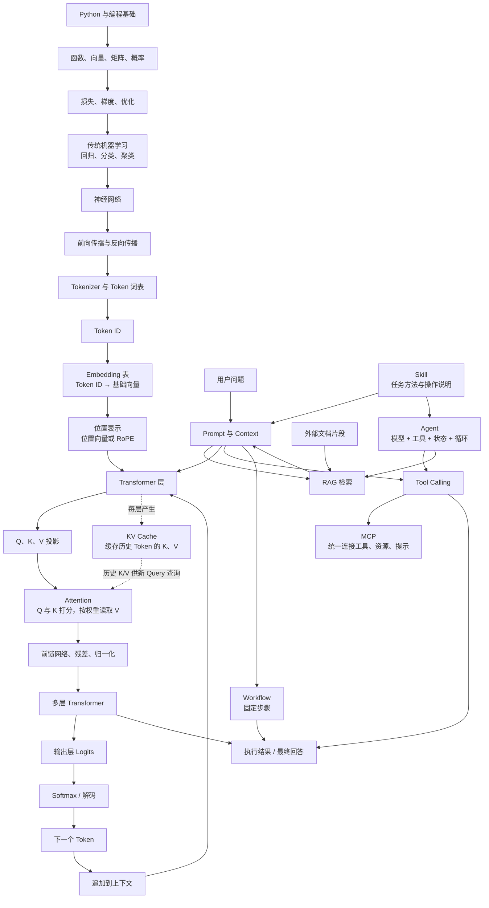

# 从基础知识到 Token、QKV、MCP、Skill、Agent

这是一张总地图。阅读时先看图，再看后面的两条主线：

- **模型内部主线**：数据和数学 → 神经网络 → Token → Embedding → Attention / QKV → Transformer → 生成 Token
- **应用系统主线**：用户请求 → Prompt / Context → RAG / Tool → MCP / Skill → Workflow / Agent

## 一、总关系图



## 二、先分清两条线

### A. 模型内部：模型如何处理文字

```text
文字
→ Tokenizer 切成 Token
→ Token ID
→ 查 Embedding 表
→ 加入位置，或在 Q/K 上应用 RoPE
→ 生成 Q、K、V
→ Attention 计算关注权重
→ 按权重混合 V
→ 前馈网络、残差、归一化
→ 重复很多层
→ 输出下一个 Token 的概率
→ 选择一个新 Token
→ 新 Token 加入上下文
→ 重复生成
```

### B. 应用系统：模型如何完成用户任务

```text
用户问题
→ 应用整理 Prompt 和 Context
→ 必要时用 RAG 找外部资料
→ 必要时调用 Tool
→ MCP 负责统一连接工具和资源
→ Skill 提供某类任务的操作方法
→ Workflow 固定步骤，或 Agent 动态决定下一步
→ 得到工具结果和模型回答
```

两条线的关系是：

```text
模型内部机制 = 模型如何计算
AI 应用工程 = 如何组织输入、工具、资料和行动
```

## 三、基础知识的依赖顺序

### 第 1 层：编程基础

你已经熟悉 Python 变量、列表和函数，可以直接从下一层开始。

还需要逐步熟悉：文件、JSON、HTTP、命令行、Git、虚拟环境和调试。

### 第 2 层：数学与数据表示

```text
函数：输入经过规则得到输出
向量：一排有顺序的数字
矩阵：很多向量组成的表格
概率：对不同结果分配信心
损失：衡量预测错误
导数 / 梯度：告诉参数往哪个方向调整
优化：不断降低损失
```

### 第 3 层：传统机器学习

```text
特征 + 标签
→ 训练模型
→ 在新数据上预测
→ 用指标评估
```

先理解回归、分类、聚类、训练集、测试集、过拟合和泛化，再进入神经网络。

### 第 4 层：神经网络

```text
输入
→ 线性变换
→ 激活函数
→ 多层组合
→ 输出
```

训练时：

```text
前向传播 → 计算损失 → 反向传播 → 梯度下降更新参数
```

## 四、模型内部：从文字到下一个 Token

### 1. Tokenizer 与词表

Tokenizer 把文字切成模型词表中的 Token。Token 不一定等于单词，可能是汉字、词的一部分、标点或特殊符号。

```text
今天的天气很好
→ 今天 / 的 / 天气 / 很好
→ 1832 / 41 / 9271 / 441
```

数字是 Token ID，只是词表中的索引，不是语义分数。

### 2. Embedding 表

模型保存一个可训练的表：

```text
Token ID → 基础向量
```

两个相同 Token 查到同一个基础向量，但它们进入句子后会因位置和上下文不同，形成不同的隐藏状态。

### 3. 位置

如果只知道 Token，不知道顺序：

```text
我 爱 你
你 爱 我
```

就难以区分。因此模型还需要位置信息。

- 位置向量方法：`Token 向量 + 位置向量`
- RoPE：根据位置旋转 Query 和 Key 的部分维度

位置不是在生成新 Token，而是帮助模型知道当前 Token 位于序列哪里。

### 4. Q、K、V

每一层 Attention 会把当前隐藏状态 `X` 变成三种角色：

```text
Q = XW_Q
K = XW_K
V = XW_V
```

- `Q`：当前 Token 想查询什么
- `K`：这个 Token 可以用什么标签被找到
- `V`：这个 Token 被找到后提供什么内容

`W_Q`、`W_K`、`W_V` 是训练得到的参数矩阵。

### 5. Attention

当前 Token 的 Query 会与所有允许看到的 Key 计算匹配分数：

```text
score(i, j) = Q_i · K_j
```

分数经过 Softmax 变成权重，再按权重混合 Value：

```text
Attention(Q, K, V) = softmax(QKᵀ / √d)V
```

不是只挑一个 Token，而是给多个 Token 分配不同权重。因果语言模型还会用遮罩阻止当前位置看到未来 Token。

### 6. Transformer 层

一个 Transformer 层通常包含：

```text
Attention
→ 残差连接与归一化
→ 前馈神经网络
→ 残差连接与归一化
```

很多层堆叠后，Token 的表示会从较简单的词形和局部关系，逐渐变成带有语法、语义和上下文的信息。

### 7. 输出下一个 Token

最后一个位置的隐藏状态经过输出层，得到词表中每个 Token 的分数：

```text
隐藏状态 → Logits → Softmax 概率 → 解码选择 → 新 Token
```

模型不是一次生成完整答案，而是不断重复预测下一个 Token。

### 8. 用户问题如何变成一个完整句子

假设用户问：

```text
苹果是什么？
```

模型不会一次性直接生成完整句子，而是进行自回归生成：每次只预测下一个 Token。

```text
已有上下文：苹果是什么？
→ 预测下一个 Token：苹果
→ 上下文变成：苹果是什么？苹果
→ 预测下一个 Token：是一种
→ 上下文变成：苹果是什么？苹果是一种
→ 预测下一个 Token：水果
→ 上下文变成：苹果是什么？苹果是一种水果
→ 预测下一个 Token：。
→ 遇到结束 Token，停止
```

上面为了直观把 Token 写成了词或短语。真实 Token 可能是汉字、多个汉字、英文单词的一部分、标点或特殊符号，因此模型预测的不是“每个字”，而是“每个 Token”。

每一步的内部过程是：

```text
当前完整上下文
→ Tokenizer / Token ID
→ Embedding 与位置处理
→ 多层 Transformer、Attention、QKV
→ 得到最后一个位置的隐藏状态
→ 输出层为词表中每个 Token 计算一个 Logit
→ Softmax 变成概率分布
→ 解码选择下一个 Token
```

例如词表中可能得到：

```text
水果：0.52
食物：0.18
植物：0.07
苹果：0.04
其他：0.19
```

模型根据解码策略选择一个 Token。选择结果加入上下文后，模型再重新预测下一步。于是后面的 Token 可以参考前面已经生成的内容。

### 9. 为什么后面的 Token 能组成连贯句子

每一步的概率不是只由当前词决定，而是由整个当前上下文决定：

```text
前面所有 Token
→ Attention 建立关系
→ 当前最后位置的隐藏状态
→ 下一个 Token 的概率
```

例如：

```text
苹果是一种
```

后面出现“水果”的概率较高；如果上下文是：

```text
苹果公司发布了一款
```

后面出现“手机”或“产品”的概率可能较高。

因此模型不是先写一个完整句子的计划，再逐字抄出来，而是通过每一步的上下文条件概率，逐步扩展文本：

```text
P(整段文本)
= P(Token1) × P(Token2 | Token1) × P(Token3 | Token1, Token2) × ...
```

### 10. 什么时候停止

模型通常在以下情况之一停止：

- 生成特殊的结束 Token，例如 EOS
- 达到最大输出 Token 数
- 应用程序检测到停止字符串
- Agent 或外部程序判断任务已经完成

所以“生成一句话”实际上是：

```text
预测 Token 1
→ 把 Token 1 放回上下文
→ 预测 Token 2
→ 把 Token 2 放回上下文
→ ……
→ 生成结束 Token 或触发停止条件
```

### 8. KV Cache

生成阶段，历史 Token 的 `K`、`V` 会被缓存：

```text
新 Token 的 Q
→ 查询历史 K Cache
→ 按权重读取历史 V Cache
→ 计算新 Token 的 K、V
→ 将新 K、V 追加到 Cache
```

通常旧 Token 的 K/V 不更新，因为因果注意力规定旧 Token 不能看后来出现的新 Token。

## 五、用户请求时：模型外部的运行链路

### 1. 不使用 RAG 或工具时

```text
用户问题
→ 系统指令 + 对话历史 + 用户问题组成 Context
→ Tokenizer
→ Transformer
→ 生成回答 Token
```

### 2. 使用 RAG 时

RAG 中要区分四个词：

```text
用户问题：原始问题
Query：用于检索的查询，可能是改写后的问题
Knowledge Base：外部知识库
Retrieved Chunks：被检索出的文档片段
```

完整流程：

```text
文档
→ 切分成 Chunks
→ Chunks 转成 Embedding
→ 存入向量数据库

用户问题
→ 生成 Query
→ Query 转成向量
→ 与文档向量比较相似度
→ 找到相关 Chunks
→ Chunks + 用户问题 + 指令组成 Context
→ LLM 根据 Context 回答
```

所以“检索相关片段”指知识库中找出的文档片段；用户问题是检索依据，不是检索片段本身。

### 3. 使用 Tool Calling 时

```text
用户目标
→ 模型判断是否需要工具
→ 模型输出结构化工具请求
→ 应用验证参数和权限
→ 应用执行工具
→ 工具结果返回 Context
→ 模型继续回答或调用下一个工具
```

模型通常不直接执行函数，而是提出请求；外围程序负责真正执行和控制权限。

## 六、MCP、Skill、RAG、Workflow、Agent 的实际关系

### MCP：连接协议，不等于知识库

MCP 主要解决：

```text
AI 应用如何发现和连接外部工具、资源和提示模板
```

它类似统一插接口。MCP Server 可以暴露三类能力：

- **Tools**：可调用的函数，例如搜索、读写文件、查询订单、执行 API
- **Resources**：可读取的上下文内容，例如文件、数据库记录、项目历史
- **Prompts**：可复用的提示模板

所以 MCP 不是“外部知识库”本身，而是连接外部工具和数据的协议。知识库可以通过 MCP 暴露出来，也可以完全不使用 MCP。

### Skill：工作方法，不等于 Tool

Skill 是某类任务的可复用说明：目标、步骤、工具规则、输出要求、示例和失败处理。

Skill 通常是说明和资源的集合，例如 `SKILL.md`、参考资料、示例和脚本。它主要告诉模型“如何完成一类工作”，不是一个单独的可调用函数。Skill 可以指导模型调用 Tool，也可以包含辅助脚本，但 Skill 和 Tool 不是同一层概念。

```text
Skill = 这类工作应该怎么做
```

### RAG：应用流程，不等于 MCP

RAG 是“先检索，再生成”的应用模式：

```text
用户问题
→ 查询知识库
→ 取得相关文档片段
→ 把片段放入模型 Context
→ 模型生成回答
```

RAG 的检索可以通过普通数据库代码、向量数据库 API 或 MCP Tool 完成。只有当 RAG 通过 MCP 连接检索服务时，才有：

```text
RAG 应用流程 → 调用 MCP Tool → 查询外部知识库
```

MCP 是连接方式，RAG 是使用检索结果增强回答的方法。

### Workflow：固定流程

```text
分类 → 检索 → 生成 → 检查
```

步骤由程序提前规定。

### Agent：动态行动系统

```text
Agent = Model + Instructions + Tools + State + Loop + Safety Controls
```

模型像大脑，Agent 是包含模型、工具、状态、循环和权限的完整行动系统。

Agent 的循环是：

```text
观察状态
→ 模型决定下一步
→ 调用工具或生成内容
→ 得到结果
→ 更新 Context / State
→ 继续或停止
```

## 七、容易混淆的四种关系

| 概念 | 它是什么 | 是否等于 Tool | 是否等于知识库 |
|---|---|---:|---:|
| Skill | 一类工作的说明、资源和方法 | 否 | 否 |
| Tool | 一个可调用的函数或动作 | 是 | 否，但可以查询知识库 |
| MCP | 连接 Tools、Resources、Prompts 的协议 | 不是某个具体 Tool | 不是，但可以连接知识库 |
| RAG | 检索资料后增强生成的应用流程 | 不一定 | 使用知识库，但不等于知识库 |

最准确的组合示例是：

```text
Skill：告诉 Agent 如何进行“公司报销审核”
MCP：让应用连接报销制度资源和查询工具
Tool：执行 search_policy(query)
Resource：提供制度文件或数据库内容
RAG：把检索出的制度片段放进 Context
Agent：决定是否检索、是否调用工具、何时结束
```

## 八、最终的完整示例

用户说：

```text
请查阅公司的报销制度，判断我的机票是否可以报销，并帮我填写申请。
```

系统可能这样工作：

```text
1. 用户问题进入应用
2. Skill 提供“报销审核”的工作方法
3. Agent 判断需要查制度
4. RAG 从公司制度库检索相关片段
5. 检索片段放入模型 Context
6. 模型判断还需要哪些信息
7. Agent 调用工具读取机票或表单数据
8. MCP 负责连接制度资源、文件工具或表单工具
9. 模型根据制度和工具结果生成判断
10. 高风险提交动作需要用户确认
11. 工具执行申请填写或提交
12. Agent 返回结果和依据
```

这里每个概念的位置是：

```text
Transformer / QKV：模型内部如何处理 Token
RAG：如何把外部资料找进 Context
Tool：如何让程序执行动作
MCP：如何标准化连接 Tool 和 Resource
Skill：如何描述一类工作的做法
Workflow：如何规定固定步骤
Agent：如何让模型动态决定步骤并循环行动
```

## 九、最简学习顺序

```text
向量与矩阵
→ 损失与梯度
→ 传统机器学习
→ 神经网络
→ Tokenizer 与 Embedding
→ 位置表示
→ QKV 与 Attention
→ Transformer
→ 生成与 KV Cache
→ Prompt 与 Context
→ RAG
→ Tool Calling
→ MCP
→ Skill
→ Workflow
→ Agent
→ 评估、安全和生产部署
```

记忆原则：

```text
模型内部：Token 如何被表示和计算
应用外部：模型如何获得资料、调用工具和完成任务
```
