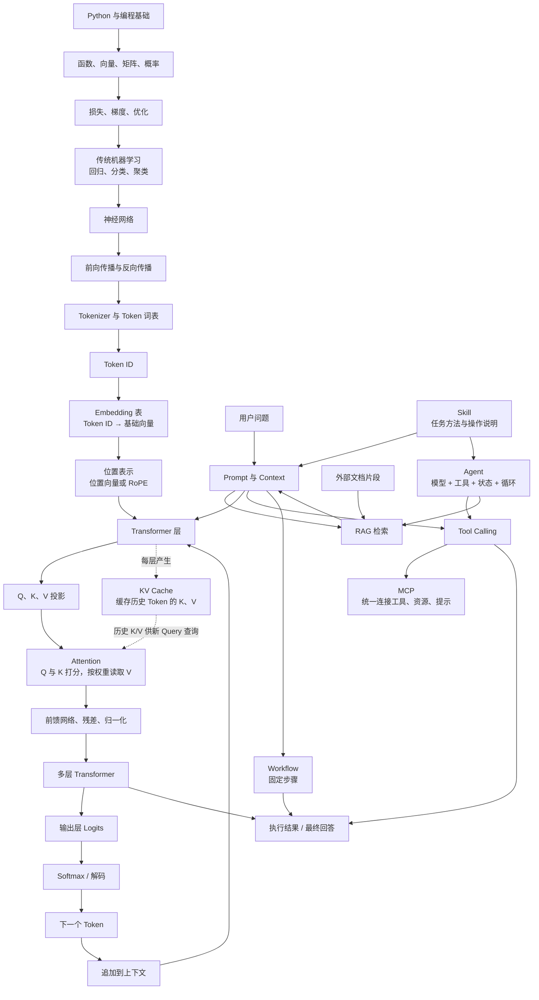

# AI 知识地图

模型内部解释“文字怎样变成输出”，应用工程解释“怎样利用模型完成任务”。这里只保留关系图，概念与示例放在对应笔记。

## 总关系图

## 阅读入口

- [[math|数学与数据]]：向量、矩阵、概率、损失与梯度。
- [[ml|机器学习]]：任务、训练集划分、评估和常见算法。
- [[neural-networks|神经网络]]：前向传播、反向传播和训练。
- [[attention|Token 与 Attention]]：分词、Embedding、位置和 QKV。
- [[transformer|Transformer]]：模型结构、训练、生成和 KV Cache。
- [[apps|LLM 应用]]：Prompt、RAG、MCP、Skill、Workflow 与 Agent。
